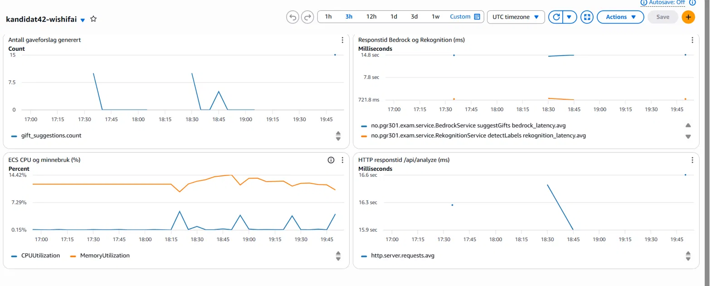

# Besvarelse PGR301 – Kandidat 42

## Oppgave 1A

Dockerfilen ligger i roten av repoet og er en multi-stage build. Det første steget bygger applikasjonen med Maven og JDK 21, og det andre steget kjører bare JAR-filen på et JRE 21-image. Da blir ikke Maven, JDK og kildekoden med i det ferdige imaget.

Imaget blir publisert til Docker Hub av pipelinen i 1B. Containeren kan startes på localhost:9999 med denne kommandoen (bruk egne AWS-nøkler):

```
docker run -p 9999:8080 -e AWS_ACCESS_KEY_ID=<access key> -e AWS_SECRET_ACCESS_KEY=<secret key> anei21638/wishifai:latest
```

Og testes med:

```
curl -F "image=@samples/sample_image.png" http://localhost:9999/api/analyze
```

## Oppgave 1B

Workflowen ligger i .github/workflows/build.yml og kjører bare ved push til main. Den bygger imaget og pusher det både til ECR (som brukes av ECS i oppgave 2) og til Docker Hub.

Grønn kjøring: https://github.com/anei035/eksamen2026DevOps/actions/runs/41339855160

ECR-repo: 244530008913.dkr.ecr.eu-west-1.amazonaws.com/kandidat42-wishifai
Docker Hub: anei21638/wishifai

Jeg tagger hvert image med kort commit-SHA (f.eks. 50d8f31) og latest. Med commit-SHA kan man se nøyaktig hvilken versjon av koden som kjører hvor, og det er lett å rulle tilbake til en tidligere versjon. Latest peker alltid på siste bygg fra main, så det er enkelt å hente nyeste versjon.

For å kjøre workflowen i en fork må sensor legge inn disse repository secrets under Settings -> Secrets and variables -> Actions: AWS_ACCESS_KEY_ID, AWS_SECRET_ACCESS_KEY, DOCKER_USERNAME og DOCKER_TOKEN.

## Oppgave 2A

Terraform-koden ligger i infra/. Den lager en ECS Express-tjeneste, en S3-bucket for bildene og en task role (wishifai-task-role-kandidat42) som gir tjenesten tilgang til Rekognition, Bedrock og S3. Execution role og infrastructure role er de eksisterende rollene i kontoen.

Offentlig URL: https://wi-ebffc86512ba4fba8b1c95659d4fd8ef.ecs.eu-west-1.on.aws

```
curl -F "image=@samples/sample_image.png" https://wi-ebffc86512ba4fba8b1c95659d4fd8ef.ecs.eu-west-1.on.aws/api/analyze
```

Jeg har variabler for region, kandidatnummer og image_tag, og URL-en kommer ut som output service_url. S3_BUCKET settes automatisk i Terraform ut fra bucketen som blir laget.

Jeg satte container_port til 8080 og health_check_path til /api/health, fordi standardverdiene (80 og /) ikke passer med applikasjonen.

## Oppgave 2B

State lagres i den delte bucketen pgr301-terraform-state med nøkkelen wishifai/42/terraform.tfstate (se infra/backend.tf). Nøkkelen har med prosjektnavn og kandidatnummer, så den er unik og ikke overskriver state til andre i klassen. Jeg bruker use_lockfile = true slik at to kjøringer ikke kan endre state samtidig.

## Oppgave 2C

Terraform-jobben ligger i samme workflow som i 1B, så workflowen har nå to jobber: build_docker_image bygger og pusher imaget, og terraform kjører terraform init, terraform fmt -check og terraform apply mot infra/. Terraform-jobben har needs: build_docker_image, så den starter først når imaget er pushet. Commit-SHA sendes inn som image_tag, slik at ECS deployer imaget som akkurat ble bygget. Pipelinen feiler hvis Terraform-koden ikke er riktig formatert.

Grønn kjøring: https://github.com/anei035/eksamen2026DevOps/actions/runs/41915763850

Terraform må kjøre etter container-bygget fordi ECS-tjenesten peker på et image med en bestemt tag. Hvis Terraform kjørte før eller samtidig, ville ikke imaget finnes i ECR ennå, og deployet ville feilet. Når den kjører etterpå, vet vi at imaget finnes, og hver commit til main blir deployet med akkurat den versjonen av koden.

## Oppgave 3A

Siden gründeren synes tjenesten er treg, måler jeg de to eksterne kallene hver for seg for å se hvor tiden blir av. I tillegg har jeg én business-metrikk. Alle metrikkene sendes til CloudWatch under namespace kandidat42.

rekognition_latency og bedrock_latency er Timere som måler hvor lang tid Rekognition og Bedrock bruker. En Timer gir antall kall, gjennomsnittstid og maks tid, så man ser ikke bare snittet, men også hvor trege de verste kallene er. Jeg har brukt @Timed på metodene i RekognitionService og BedrockService, med TimedAspect registrert i TimedConfig.

gift_suggestions er en Counter som teller antall gaveforslag som blir generert. Jeg valgte denne som business-metrikk fordi gaveforslagene er selve produktet Wishifai leverer. Den viser hvor mye tjenesten faktisk brukes og hvor mye verdi den gir brukerne, noe gründeren kan vise til overfor investorer. Hvis den plutselig stopper opp, vet vi at brukerne ikke får verdi lenger, selv om tjenesten teknisk sett svarer. Jeg brukte Counter fordi antallet bare kan øke.

Resultatet var at Bedrock-kallet i snitt tar rundt 14,5 sekunder, mens Rekognition tar rundt 1,1 sekunder. Bedrock står altså for omtrent 93 % av responstiden og er hovedgrunnen til at tjenesten er treg.

## Oppgave 3B

Dashboardet og alarmen ligger i infra/dashboard.tf og infra/alarm.tf.

Dashboardet heter kandidat42-wishifai og ligger i CloudWatch i eu-west-1.



Dashboardet har fire grafer som til sammen gir et bilde av både bruk, ytelse og infrastruktur:

- Antall gaveforslag generert er business-metrikken fra 3A. Den viser hvor mye tjenesten faktisk brukes.
- Responstid for Bedrock og Rekognition viser de to Timerne fra 3A i samme graf, slik at man med en gang ser at det er Bedrock som tar mest tid.
- ECS CPU og minnebruk er infrastrukturmetrikker som ECS Express sender automatisk. De viser om tjenesten har nok ressurser, eller om tregheten kan skyldes for lite CPU eller minne.
- HTTP responstid for /api/analyze kommer fra Spring Boot Actuator og viser den totale tiden brukeren venter på svar.

Alarmen går på bedrock_latency, siden det er Bedrock som står for det meste av responstiden. Den går av hvis gjennomsnittlig tid er over 20 sekunder i to minutter på rad, og sender da e-post via SNS. Bedrock ligger normalt på rundt 15 sekunder, så 20 sekunder betyr at tjenesten er merkbart tregere enn vanlig. At den må være over terskelen i to perioder gjør at én enkelt treg forespørsel ikke utløser alarmen.

## Oppgave 4

Da jeg testet Wishifai med barnerombildet, fant Rekognition både "Living Room" og "Bedroom" i samme bilde, og modellen svarte at det var en blanding av stue og soverom. Svaret ble til slutt greit, men samme bilde gir ikke nødvendigvis samme svar neste gang. Pipelinen var grønn, health-sjekken svarte og alarmen sto i OK hele tiden. Ingenting av det sier noe om forslagene faktisk er riktige, og det synes jeg er den største forskjellen fra vanlig utvikling.

En vanlig test sjekker at output er lik en forventet verdi, men det går ikke når svaret varierer. Formatet kan fortsatt testes automatisk, for eksempel at svaret er gyldig JSON. Innholdet kan testes med et fast sett bilder, som et barnerom og en garasje, i en egen jobb som deploy-jobben har needs: på. Slike tester fanger bare feilene man selv har tenkt på, og de koster tid og penger hver gang pipelinen kjører. Man får aldri samme trygghet som med vanlige enhetstester.

Det er heller ikke bare koden som endrer oppførselen. Prompten og modellversjonen kan gi helt andre svar selv om ingen kode er endret. Prompten kan versjoneres i Git og gå gjennom samme pipeline som koden, med pull request og statussjekker slik vi satte opp med branch protection. Da får den en commit-SHA og kan rulles tilbake. Modellen er vanskeligere, siden det er leverandøren som oppdaterer og fjerner versjoner. Canary eller feature flags hjelper, men bare hvis man har et signal som sier om den nye versjonen faktisk gir bedre svar.

Alarmen min går hvis Bedrock bruker mer enn 20 sekunder i snitt. Den ville ikke reagert om modellen plutselig foreslo noe farlig for et lite barn, og business-metrikken min ville bare telt det som fem nye gaveforslag. Man kan måle hvor ofte modellen nekter å svare, hvor lange svarene er og tokenbruk, men ingen av disse sier direkte om et svar er riktig. Tilbakemeldinger fra brukere er nok det beste signalet på kvalitet, men de kommer først etter at feilen har skjedd.

Hvor strengt dette må være, avhenger av risikoen. For en gaveliste synes jeg det er greit å oppdage noen feil i produksjon, så lenge man kan rulle tilbake raskt. Et dårlig gaveforslag er irriterende, men det er brukeren som bestemmer om gaven blir kjøpt. I en bank er det annerledes. Der bør endringer i prompt og modell godkjennes av et menneske, og rådgiveren bør se over rådet før kunden får det. Flere sperrer og manuelle godkjenninger øker riktignok lead time og gjør at man deployer sjeldnere, men et feil råd om pensjon eller lån kan ikke rulles tilbake med et eldre image.